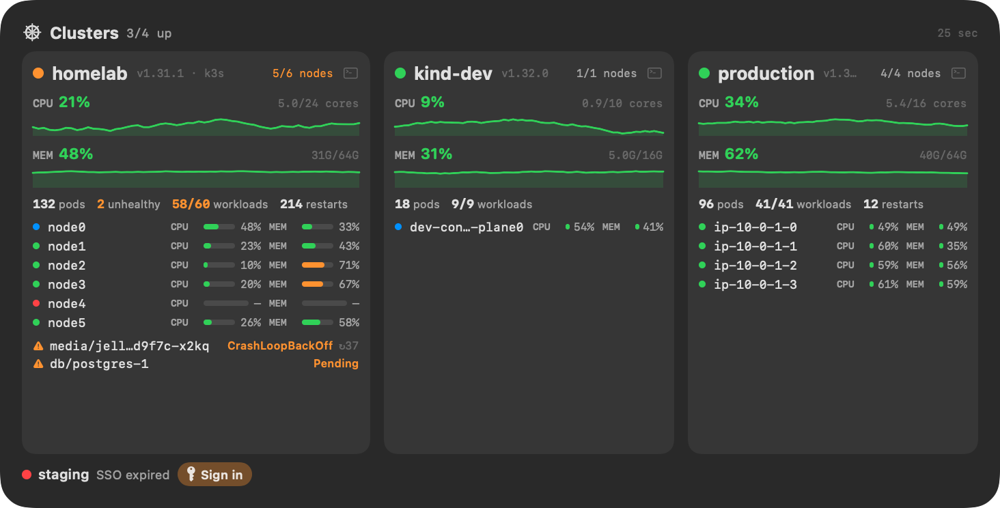
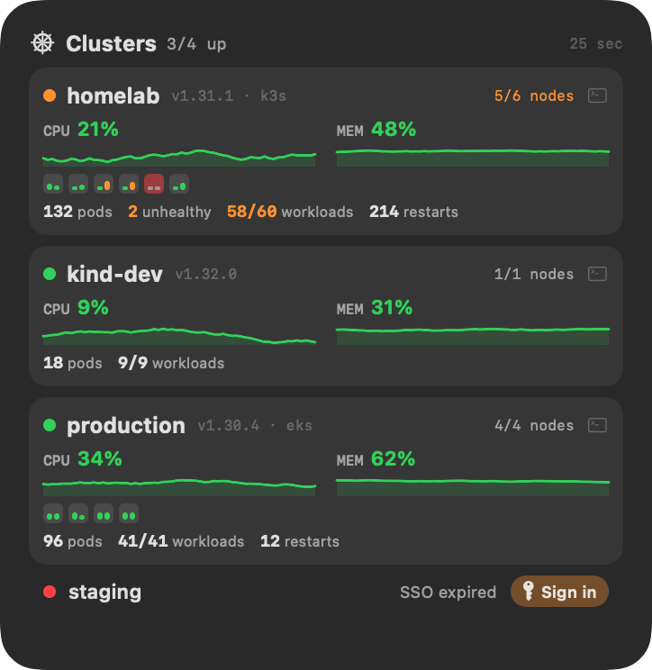
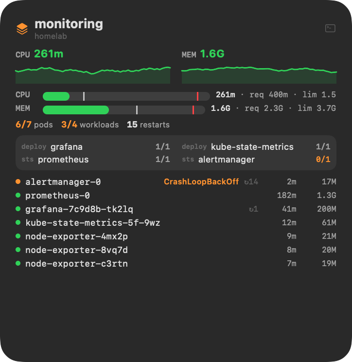
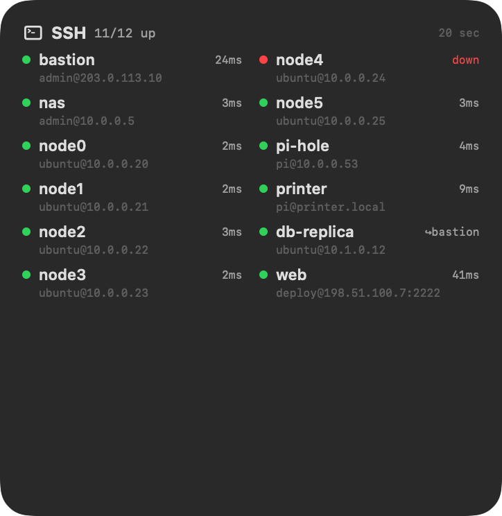

# KubeWidget

Native macOS desktop widgets for your Kubernetes clusters and SSH hosts. Health, CPU and memory for every kube context at a glance, and one click to open [k9s](https://k9scli.io) or an SSH session in your terminal.



- **Real WidgetKit widgets.** They sit on the desktop alongside your other widgets, in any size macOS offers.
- **Built from your kubeconfig and `~/.ssh/config`.** Nothing to configure: every context and host shows up automatically.
- **One click to act.** Click a cluster to open k9s on it, a namespace to open k9s on its pods, or a host to SSH in. Expired AWS SSO sessions get a **Sign in** button.
- **Local only.** KubeWidget runs `kubectl`, `aws` and `ssh -G` on your Mac. No accounts, no telemetry, no servers.

## Widgets

| Widget | Sizes | Shows |
|---|---|---|
| **Clusters** | medium, large, extra large | Every context (or the ones you pick): status, CPU/memory with an hour of history, nodes, pods, workloads, restarts and the worst failing pods. Adapts to how many contexts you have. |
| **Cluster** | small, medium, large | One context in detail, with per-node usage. |
| **Namespace** | small, medium, large | One namespace: usage against requests and limits, deployments and statefulsets, and its busiest or failing pods. |
| **SSH** | small, medium, large, extra large | Hosts from `~/.ssh/config` with reachability and latency. Pick a subset and give it a title, e.g. "Homelab". |

<p>
  
  
  
</p>

A menu bar icon (⎈) lists the same clusters and hosts, and holds the settings: terminal app, which contexts to poll, and Open at Login.

## Requirements

- macOS 14 Sonoma or later
- [Xcode](https://apps.apple.com/app/xcode/id497799835) 16 or later (the full app; the Command Line Tools alone can't build widgets)
- [XcodeGen](https://github.com/yonaskolb/XcodeGen): `brew install xcodegen`
- An **Apple Development** signing certificate. macOS only loads signed widgets. A free Apple ID is enough:
  Xcode → Settings → Accounts → add your Apple ID → select it → **Manage Certificates…** → **+** → **Apple Development**.

At runtime:

- `kubectl` for the cluster widgets, and [metrics-server](https://github.com/kubernetes-sigs/metrics-server) in each cluster for CPU and memory (everything else works without it)
- `k9s` (recommended) to open clusters and namespaces on click. Without it, a click opens a terminal switched to that context with `kubectl config use-context`.
- `aws` CLI v2, if you use EKS with AWS SSO

## Install

```sh
git clone https://github.com/imaustink/macos-widgets.git
cd macos-widgets
make install
```

This builds the app, signs it with your certificate (your Team ID is detected automatically), copies it to `~/Applications`, and launches it. Then:

1. **Add widgets:** right-click the desktop → **Edit Widgets…** → search "KubeWidget" and drag one out.
2. **Allow Local Network access** when macOS asks. It's needed for clusters and hosts on your LAN; without it they show as "no route" or "timeout".
3. **Pick what a widget shows:** right-click it → **Edit "Clusters"** (or Namespace, SSH…).
4. **Keep it running:** menu bar icon → **Open at Login**. The widgets only update while the app is running.

To update, `git pull && make install`. Your widgets and settings are kept.

Options, if you need them:

```sh
TEAM=ABCDE12345 make install             # choose a signing team (if you have several)
INSTALL_DIR=/Applications make install   # install somewhere else
```

## Uninstall

```sh
make uninstall
```

This removes the app and its widgets, unregisters the login item, and deletes its cached data, caches and preferences. Use `scripts/uninstall.sh --keep-data` to keep the data for a later reinstall.

If you've already deleted the cloned repo, the manual equivalent is: quit KubeWidget from the menu bar, turn off **Open at Login** first if it was on, then delete `KubeWidget.app` and `~/Library/Group Containers/*.group.com.austinkurpuis.kubewidget`.

## Usage

- **Click a cluster** to open k9s on that context. **Click a namespace widget** to open k9s on that namespace's pods. **Click an SSH host** to run `ssh <alias>`.
- **No k9s?** Clicking a cluster or namespace instead runs `kubectl config use-context <context>`, shows its nodes or the namespace's pods, and leaves you in a shell. Note that this changes your kubeconfig's current context.
- **Terminal:** menu bar → **Terminal** picks Terminal, iTerm2, Ghostty, Warp, WezTerm or kitty (whichever are installed).
- **AWS SSO:** EKS contexts whose kubeconfig uses `aws eks get-token` with `AWS_PROFILE` or `--profile` show **Sign in** when the session expires. Clicking it runs `aws sso login --profile <profile>`. The menu has **Sign In to All Expired AWS SSO**.
- **Stop polling a context:** menu bar → **Contexts**, then untick it. This is for contexts you keep but don't want probed (e.g. ones that are usually offline).
- **Refresh now:** menu bar → **Refresh Now** (⌘R).

### Status reasons

| Shown | Meaning |
|---|---|
| `SSO expired` / `AWS auth failed` | The AWS session behind an EKS context expired. Click **Sign in**. |
| `no route` / `timeout` on a LAN cluster | Usually macOS Local Network permission. See [Troubleshooting](#troubleshooting). |
| `offline` / `refused` / `DNS failed` | The API server isn't reachable (cluster stopped, VPN down…). |
| `unauthorized` / `forbidden` | Your credentials for that context were rejected. |
| CPU/MEM `—` | The cluster has no metrics-server, so `kubectl top` returns nothing. |

SSH hosts that don't answer show one of these instead of latency:

| Shown | Meaning |
|---|---|
| `blocked` | macOS stopped the connection before it left your Mac, usually the Local Network permission. See [Troubleshooting](#troubleshooting). |
| `no route` | No network path to the host (VPN down, wrong network). On a LAN host this can also be the Local Network permission. |
| `timeout` | Nothing answered within 2.5 seconds: the host is off, or a firewall is dropping the connection. |
| `refused` | The host is up but nothing is listening on its SSH port. |
| `DNS failed` | The hostname didn't resolve. |

## How it works

KubeWidget is two parts, because widgets are sandboxed and can't run commands:

- **KubeWidget.app**, a menu bar app, polls once a minute. For each context it runs `kubectl get nodes`, `kubectl top nodes`, `kubectl top pods -A`, `kubectl get pods -A` and `kubectl get deploy,sts -A` in parallel, with timeouts. For SSH it resolves each alias with `ssh -G` and opens a TCP connection to the host's SSH port (no login). It writes the results as JSON to a shared App Group container.
- **The widget extension** reads that JSON and draws it. Clicks open `kubewidget://` links, which the app handles by launching k9s, ssh or `aws sso login`.

The app reads `PATH` and `KUBECONFIG` from your login shell at startup, so tools installed with Homebrew, asdf, Nix and the like are found. If you change them, quit and reopen KubeWidget.

macOS limits how often a widget may redraw. KubeWidget redraws right away when something meaningful changes (a context appears or goes down, nodes or pods turn unhealthy, sign-in starts or ends), and otherwise refreshes CPU and memory every 15 minutes.

## Troubleshooting

**LAN clusters or hosts show "no route" / "timeout" / down, but work from Terminal.**
macOS's Local Network privacy blocks the app. Open System Settings → Privacy & Security → **Local Network** and turn on **KubeWidget**. macOS may reset this when the app is rebuilt, so check again after `make install`.

**The widgets don't show up in Edit Widgets, or show old widgets after updating.**
Run `make install` again (it restarts the macOS widget service). If that doesn't do it, log out and back in.

**A widget is stuck on old data.**
Check KubeWidget is running (⎈ in the menu bar), then use **Refresh Now**. macOS throttles widget redraws, so a widget can lag a few minutes behind the menu.

**`kubectl`, `k9s` or `aws` not found.**
Make sure they're on the `PATH` of your login shell (`zsh -lic 'which kubectl'`), then quit and reopen KubeWidget.

**`make install` says there's no signing certificate.**
See [Requirements](#requirements). If you have certificates for several teams, choose one with `TEAM=XXXXXXXXXX make install`. Your Team ID is in the certificate name shown by `security find-identity -v -p codesigning`.

## Contributing

Bug reports, ideas and pull requests are welcome. See [CONTRIBUTING.md](CONTRIBUTING.md) for how the code is organized and the development loop. You can render every widget to a PNG without installing anything.

## License

[MIT](LICENSE) © Austin Kurpuis

KubeWidget is not affiliated with the Kubernetes project, the CNCF or k9s.
